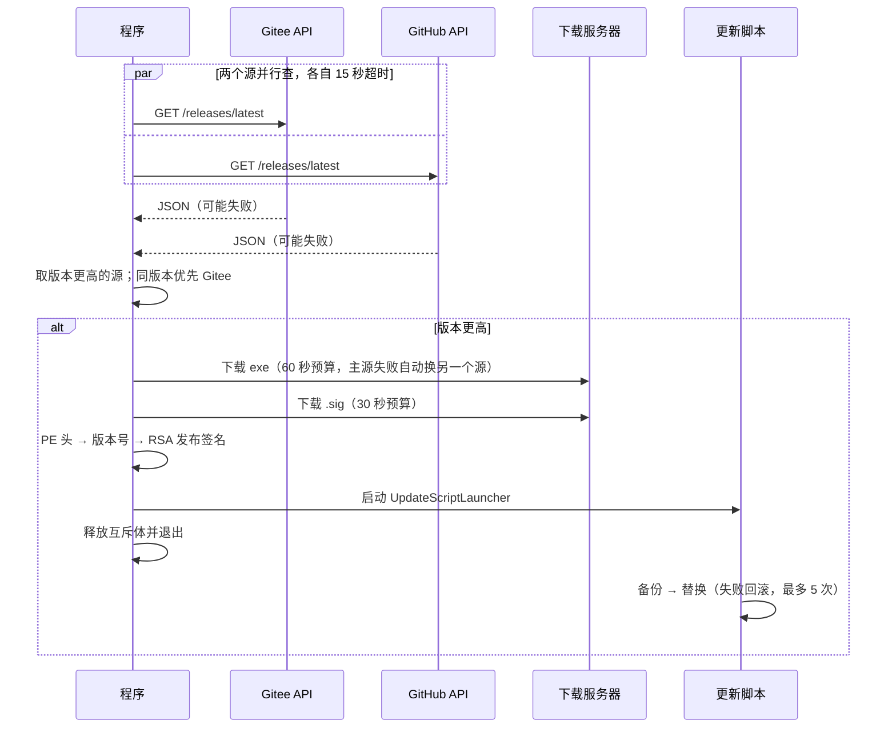

# 陈叔叔希沃优化助手 (SeewoOptimizer)

**PEACE & LOVE | 川中计算机协会成员 荣誉出品**

---

## 📖 简介

陈叔叔希沃优化助手是一款面向**老希沃 / 多媒体教室**、主要针对 **Windows 7** 的轻量级桌面工具。它是为了解决几件在教室里常见的问题：

- 主板电池失效或 Windows Time 服务异常，**系统时间停在 “清朝”**；
- **音量太小、老师又不会调**，同学们没法愉快地看课件里的视频（不知道要先退出 PPT 才能调系统音量）；
- **WPS 2019 打不开课件**，得先结束 `wps.exe` 再重新打开；
- 放学后老是忘记关机，长时间通电和突然断电都伤机器——加了**计划自动关机**（如果你心疼班里那台电脑的话）。

现在它还包括**计划自动关机**、**守护天数**、常驻托盘、开机自启，以及带签名校验的自动更新。程序绿色免安装——exe 放哪就在哪跑，设置存在当前用户的注册表里；首次运行只在 exe 同目录释放一个任务计划依赖的 DLL。整体是「绿色、可静默、可自动」：静默启动和自动开始执行既定任务需要预先在设置里打开。

> **默认不会在启动时自动执行任务。** 便于第一次启动时在设置中调试，后续在设置里勾选「程序启动时自动开始执行既定任务」即可开启自动化。

---

## ✨ 功能特性

| 功能 | 说明 |
|------|------|
| 🕐 **NTP 时间同步** | 10 个时间服务器，国内源优先（阿里云、国家授时中心、`cn.pool.ntp.org`），境外源兜底；校验 Mode / Stratum / 闰秒标志，失败自动切换 |
| ⏰ **定时关机** | 最多 5 个时间点，可设为每天或指定星期几；关机前 5 分钟弹窗提醒，到点立即执行；错过 10 分钟内会补执行 |
| 📅 **守护天数** | 窗口顶部显示「已守护本电脑 x 天」；首次运行当天算第 0 天，只在时间同步成功后刷新 |
| 🔊 **系统音量调节** | 可设置 0–100 的目标音量，调用 Windows Core Audio API 调主音量（默认 60%） |
| 🧹 **结束 WPS 进程** | 清理 `wps` / `wpp` / `et` / `wpscloudsvr` / `ksolaunch` |
| 🔄 **开机自启** | 通过 Windows 任务计划实现用户登录后延迟 5 秒启动，无需管理员权限 |
| 🤫 **静默启动** | 启动后不显示窗口，直接进托盘 |
| ▶️ **程序启动时自动开始执行既定任务** | 可选开关，默认关闭；从旧版升级的机器会自动勾选，保持原来的使用习惯 |
| 📌 **常驻托盘** | 同步完成后不退出，继续守候关机时间点；点 × 只缩托盘，退出走菜单或托盘 |
| 📦 **自动更新** | 后台检测 GitHub Releases，下载后校验 RSA 发布签名，静默替换；时钟错误导致失败时会在校时后重试 |
| 📝 **分段日志** | 每次运行单独分段，保留最近 5 次；记录在 `%LOCALAPPDATA%\SeewoOpt\startup.log` |
| 🧹 **一键卸载** | 输入暗号 `0319` 后清理数据目录、注册表、任务计划，并停止关机守候（exe 需手动删除） |

---

## 🖼️ 界面


> 截图可能滞后于最新版本，以实际界面为准。

- 上半屏是「已守护本电脑 x 天」，下半屏是执行日志与状态行。
- 底部按钮：**开始执行 / 重新同步 / 隐藏到托盘 / GitHub 仓库 / 卸载程序**；从托盘恢复时还会出现「显示窗口」。
- 菜单栏：**选项**（设置、退出）、**日志**（打开日志）。
- 托盘右键：**显示窗口 / 立即同步时间 / 退出程序**。

---

## 🚀 使用方法

### 1. 首次运行

从 [Release 发布页](https://github.com/Foxelf-Studio/SeewoOptimizer/releases) 下载最新版，放到任意文件夹，双击 `SeewoOpt.exe`。

首次启动会：

1. 按「开机自启」设置（默认开启，可在设置里关闭）创建登录任务；
2. 显示主窗口，停在「已就绪，点击左下角开始执行」；
3. 在后台检查一次新版本。

点击左下角 **开始执行** 后，才会依次执行：

- 调节系统音量（默认 60%，可在设置里关闭）；
- 结束 WPS 相关进程（可在设置里关闭）；
- 从 NTP 服务器同步时间；
- 同步成功后刷新守护天数，并缩到托盘常驻；
- 如果启动时更新检查因时钟错误失败，校时成功后自动重试。

> 从 v26.6.9 及更早版本升级的机器会自动勾选「启动时自动执行」，确保已经设置好的机器不需要经过设置就可以无缝体验新版，维持免打扰的特性；新用户默认不勾。

### 2. 设置

菜单栏 **选项 → 设置**：

| 选项 | 默认 | 说明 |
|------|------|------|
| 开机自启动 | 开 | 登录后延迟 5 秒启动（任务计划） |
| 静默启动 | 关 | 启动时不显示主窗口，直接进托盘 |
| 程序启动时自动开始执行既定任务 | 关 | 勾选后启动 2 秒自动点一次「开始执行」 |
| 自动执行音量调节 | 开 | 执行时把主音量设为右侧数值（0–100） |
| 自动执行结束 WPS 进程任务 | 开 | 执行时清理 WPS 相关进程 |
| 定时关机 | 空 | 最多 5 条；每条含时间、「每天」开关与七个星期按钮；关机前 5 分钟提醒 |

设置保存在注册表 `HKCU\Software\TimeSyncTool`。注册表路径与任务计划名**刻意保留** `TimeSyncTool`，避免老用户升级后设置丢失、自启任务失联。

### 3. 开始 / 重新同步

- 首次使用点 **开始执行**；
- 之后可点 **重新同步**，或托盘菜单 **立即同步时间**；
- 同步失败不会退出程序，网络恢复后可再次点击；
- 权限不足时会提示以管理员身份重启。

### 4. 托盘与退出

- 点窗口右上角 **×** 只缩到托盘，程序继续守候关机时间点；
- 托盘图标双击恢复窗口；
- 真正退出只有两条路：**选项 → 退出**、托盘 **退出程序**；
- ***配了***关机时间点时，退出前会提示“退出后关机时间点将不再生效”。

> 常驻托盘的正当理由其实只有一条：守候关机时间点。剩下的都算先埋的坑——万一以后有用呢？

### 5. 查看日志

菜单栏 **日志 → 打开日志** 会打开数据目录并选中 `startup.log`。日志按运行分段，保留最近 5 次；被强杀的那次没有结束标记，一眼能看出上次是异常终止。

### 6. 卸载

点击 **卸载程序** → 输入暗号 `0319` → 确认后：

- 先停止关机巡检并清空规则；
- 删除 `%LOCALAPPDATA%\SeewoOpt`（日志、关机记账、更新缓存）；
- 顺带清理旧版遗留的 `%LOCALAPPDATA%\TimeSyncTool`；
- 删除注册表 `HKCU\Software\TimeSyncTool`；
- 删除任务计划 `TimeSyncTool`。

程序 exe 与 `Microsoft.Win32.TaskScheduler.dll` 需手动删除（运行中无法自删）。

暗号 `0319` 防止他人***纯净***卸载。但别人想不纯净地卸载直接把exe删了不就卸载了吗？

---

## ⚠️ 行为说明

- **默认不自动执行**：全新安装后需要点一次「开始执行」，或在设置里勾选自动执行。
- **关机补执行**：关机点后 10 分钟内恢复（休眠唤醒、重启、卡顿），会补关一次；超过 10 分钟放弃并写日志。补执行不弹确认框——提前 5 分钟的提醒框是唯一确认窗口。
- **关机状态跨重启**：承诺时刻、本次不关机标记、已执行标记写在 `shutdown-state.txt`；重启后会恢复。**“已提醒”不落盘**，所以在提醒窗口内重启（且未点过“本次不关机”）会再问一次，并把承诺顺延为「现在 + 5 分钟」。
- **任务管理器结束任务会被拦截**，防止绕过关机管理；系统关机/注销会正常放行，不会出现「此程序正在阻止 Windows 关闭」。
- **数据目录与标识**：数据目录是 `%LOCALAPPDATA%\SeewoOpt`；注册表与任务计划名仍是 `TimeSyncTool`。判断“能不能改名”的标准是有没有不可再生的用户数据，而不是名字像不像内部代号。
- **运行环境**：Windows 7 SP1 及以上，.NET Framework **4.8**。

---

## 🛠️ 实现原理

### 1. 时间同步（NTP）

- UDP 123 端口，48 字节 NTPv4 报文，解析 `transmit timestamp`。
- 校验 **Mode = 4（服务器应答）**、**Stratum 1–15**、**Leap Indicator ≠ 3**；不合格的响应直接丢弃。
- 时间合理性只用绝对边界（2000-01-01 ~ 2036-02-07），**不拿本机时钟做判断**——本机时钟本来就是待修对象。
- 每次查询连发 2 个 UDP 包，连接、发包、收包共用一个 5 秒总预算；前 4 个是国内源，全部失败后才用境外备用源。
- 写入系统时间用 `SetSystemTime`（收 UTC），**不做任何时区换算**；需要显示本地时间时才用 `ToLocalTime`。

### 2. 定时关机

- 每 20 秒巡检一次，**到点窗口优先于提醒窗口**。
- 提醒窗口 5 分钟；提醒弹出时把承诺定成 `max(现在 + 5 分钟, 规则时刻)`，保证用户看到满 5 分钟。
- 到点后 10 分钟内补执行；超过则放弃。承诺、跳过、已执行三笔账写入 `%LOCALAPPDATA%\SeewoOpt\shutdown-state.txt`。
- 关机命令通过 `%SystemRoot%\System32\shutdown.exe` 绝对路径执行，参数 `/s /t 0`，不叠加系统倒计时。

### 3. 音量与 WPS 清理

- 音量：Core Audio API，取默认渲染设备后调 `SetMasterVolumeLevelScalar`（0.0–1.0）。
- WPS：结束 `wps` / `wpp` / `et` / `wpscloudsvr` / `ksolaunch`，每个 `Process` 对象用完即释放，并等待进程真正退出。

### 4. 开机自启

- 使用 `Microsoft.Win32.TaskScheduler` 创建任务计划，触发器为“用户登录后延迟 5 秒”，动作为当前 exe。
- 启动时会检查任务是否存在，与设置不一致时自动修正。

### 5. 自动更新



- **两个源**：Gitee 与 GitHub 并行查询，各自 15 秒超时。任一源通就能出结果，取版本更高的那个；版本相同时优先用 Gitee 下载（国内可达）。
- **三个校验**：PE 头 → **版本号 == 目标版本** → RSA 签名。
- Release 用 `DataContractJsonSerializer` 解析；资产按 `.exe` / `.msi` 筛选，排除 `.sig` 等附属文件。Gitee 的资产没有 `size` 字段，程序不依赖它。
- **签名是唯一的信任锚**：RSA / PKCS#1 v1.5 / SHA-256；SHA256 只记录，不阻止更新。
- 下载总预算 180 秒：两轮 × 两个源，任何一种网络状况都不会让“检查更新”变成无限等待。
- 更新脚本把路径转义后写进批处理，不再通过环境变量传递；替换前备份旧 exe，失败自动回滚并写 `UPDATE_FAILED`，下次启动会记一条明确的失败日志并清理标记。
- 时钟错误会让 HTTPS 证书校验失败；启动时那次更新检查失败后，会在时间同步成功后自动重试，等待上限 60 秒。
- 两个源都不可用时不报错、不影响关机与同步，只在日志里记一行——教室机器经常整月连不上外网，这属于正常状态。
- 日志里若出现 `GitHub 版本查询失败：API 限流（403）`，那不是被墙，而是同一出口 IP 每小时 60 次的未认证额度用完了。

### 6. 单实例与退出

- 全局互斥体 `TimeSyncTool_UniqueMutex` 防止多开；抢不到实例时只弹提示，不碰日志文件。
- 所有退出路径统一走 `Program.Shutdown()`：先等后台同步线程收尾，再释放互斥体、写日志结束标记，最后退出。

### 7. 日志

- 每次启动写分隔头与运行序号，结束写结束标记；只保留最近 5 次。
- 写入用 UTF-8 无 BOM，多线程写入加锁；超长消息截断到 4000 字符。

---

## 📁 项目结构

```
SeewoOptimizer/
├── WindowsFormsApp1/                     # 主工程（net48 WinForms，非 SDK-style）
│   ├── Program.cs                        # 入口、单实例、自动更新、DLL 提取
│   ├── Properties/TimeSyncForm.cs        # 主窗体、托盘、同步流程、关机巡检
│   ├── SettingsForm.cs                   # 设置窗体（含关机时间点编辑）
│   ├── ShutdownWarningDialog.cs          # 关机提醒自绘对话框
│   ├── Services/
│   │   ├── NtpClient.cs                  # NTP 解析、查询、系统时间写入
│   │   ├── ShutdownSchedule.cs           # 关机规则、星期掩码、提醒/到点判定
│   │   ├── ShutdownService.cs            # 关机巡检、承诺/跳过记账、执行 shutdown
│   │   ├── SettingsStore.cs              # 注册表设置持久化、读改写串行化
│   │   ├── LogService.cs                 # 分段日志、裁剪
│   │   ├── GuardDayPolicy.cs             # 守护起始日可信度判定
│   │   ├── SignatureVerifier.cs          # 发布签名验证（多公钥）
│   │   ├── ReleaseInfoParser.cs          # Release JSON 解析与资产筛选
│   │   ├── UpdateScriptLauncher.cs       # 更新脚本生成与启动
│   │   ├── AutoStartService.cs           # 任务计划开机自启
│   │   ├── AutoStartTaskUpgradePolicy.cs # 旧版升级时补勾自动执行
│   │   ├── ProcessCleaner.cs             # 结束 WPS 进程
│   │   ├── VolumeController.cs           # Core Audio 音量
│   │   ├── SessionClosePolicy.cs         # 系统关机/注销放行策略
│   │   └── BuildInfo.cs                  # BuildId + exe SHA256 + 写入时间
│   ├── Microsoft.Win32.TaskScheduler.dll # 任务计划依赖（内嵌资源）
│   └── well.ico                          # 程序图标（嵌入资源）
├── WindowsFormsApp1.sln
├── tools/                                # 测试、探针、构建脚本
│   ├── sync.cmd / build.cmd / publish.cmd
│   ├── NtpClientTests.cs                 # 单元测试：NTP / 关机 / 守护天数 / 设置 / 签名
│   ├── ShutdownSessionProbe.cs           # 关机链路探针（真实窗口消息）
│   ├── UpdateLaunchProbe.cs              # 更新替换演练（真实模板 + 真实进程）
│   ├── UpgradeMigrationProbe.cs          # 升级迁移演练（真实注册表，可回滚）
│   ├── UpdateRetrySimulation.cs          # 更新重试时序模拟
│   ├── DialogRender.cs                   # 把提醒框渲染成 PNG，供人眼核对
│   └── Directory.Build.props             # 各工具工程独立 obj
├── docs/verify-guard-days.md             # 守护天数手工验证步骤
├── .github/workflows/build.yml           # CI：编译 + 单测 + 探针 + tag 校验
├── RELEASING.md                          # 发布流程与密钥轮换
└── LICENSE
```

---

## 🔧 编译与运行

### 环境要求

- Windows 7 SP1 或更高版本
- .NET Framework **4.8**（运行时与编译目标）
- Visual Studio 2022，或能提供 net48 参考程序集的 MSBuild 环境

### 用 Visual Studio 2022

1. 克隆仓库：
   ```bash
   git clone https://github.com/Foxelf-Studio/SeewoOptimizer.git
   ```
2. 打开 `WindowsFormsApp1.sln`；
3. 还原 NuGet 包（只需 `TaskScheduler 2.12.2`）；
4. 编译 Release / AnyCPU；
5. 运行 `WindowsFormsApp1\bin\Release\SeewoOpt.exe`。

### 命令行

```bat
dotnet build WindowsFormsApp1\WindowsFormsApp1.csproj ^
  -c Release ^
  -p:TargetFrameworkRootPath=<net48 参考程序集根目录>
```

命令行编译前需要先还原 `packages.config` 里的 `TaskScheduler 2.12.2`，并把参考程序集根目录指到含 `.NETFramework\v4.8` 的那一层。

`tools/build.cmd` / `publish.cmd` 是维护者本机构建工位的脚本：它们假定仓库位于 `<构建根>\_repo`，并镜像到 `G:\SeewoBuild\proj`，再使用本机自备的参考程序集与 NuGet 包。普通克隆直接用 Visual Studio 即可；维护者的完整流程见 [RELEASING.md](RELEASING.md)。

### 自动化校验

CI 在每次 push / PR / `v*` 标签时运行：编译 net48、跑单元测试与关机/更新/升级迁移三个探针；标签构建还会校验 **tag 与产物 FileVersion 一致**。

```bash
cd tools
dotnet run --project NtpClientTests.csproj -c Release        # 228 项断言
dotnet run --project ShutdownSessionProbe.csproj -c Release   # 关机链路探针，退出码 0=通过
dotnet run --project DialogRender.csproj -c Release           # 渲染提醒框 PNG
dotnet run --project UpdateLaunchProbe.csproj -c Release      # 更新替换演练
dotnet run --project UpgradeMigrationProbe.csproj -c Release  # 升级迁移演练（真实注册表，可回滚）
```

**关于 `ShutdownSessionProbe`**：它验证的是“窗口消息层”的行为——系统关机时本程序是否会被判定为「阻止 Windows 关闭」。这类缺陷不在纯函数里，单元测试测不到，只能用真实窗体 + 真实 `SendMessage` 投递 `WM_QUERYENDSESSION` / `WM_SYSCOMMAND(SC_CLOSE)`，直接读回窗口过程的返回值。

**关于 `UpgradeMigrationProbe`**：它在临时注册表键上跑完整生命周期——伪造旧版安装 → 跑迁移 → 校验结果 → 删除临时键，涵盖“老用户被补勾”与“全新安装不被误判”两条路径，结束时必定清理。

> CI 只做编译与测试校验，不发布产物——发布需要对 exe 用本机私钥签名，而私钥绝不能上传到云端。

---

## 📅 守护天数验证

“已守护 x 天”只在**跨过午夜**时 +1，而且只在**时间同步成功后**才刷新，所以当天无法自然验证。完整的手工验证步骤（含注册表改法、错误起点复现、时钟不准的场景）见 [docs/verify-guard-days.md](docs/verify-guard-days.md)。

---

## 📄 许可证

本项目采用 **GNU Affero General Public License v3.0（AGPL-3.0）**。

Copyright (C) 2025-2026 **Foxelf Studio**

完整条款见仓库根目录的 [LICENSE](LICENSE) 文件。你可以自由使用、修改和分发本项目，包括用于商业目的，但须遵守以下两条核心义务：

1. **衍生作品必须以同样的 AGPL-3.0 许可证开源。** 如果你修改了本项目并对外分发，必须提供完整的对应源代码。
2. **网络服务同样适用。** 如果你基于本项目修改后部署为网络服务供他人使用，必须向这些用户提供你修改后的源代码。（这是 AGPL 相对于普通 GPL 的关键附加条款，也是选择它的原因。）

简单说：**拿去用可以，改了要开源，别把改进藏起来。**

> 本项目为教学场景下的实用工具，按“现状”提供，不附带任何明示或暗示的担保。详见 LICENSE 第 15、16 条。

---

## 🤝 贡献与反馈

- 提交 Issue：[GitHub Issues](https://github.com/Foxelf-Studio/SeewoOptimizer/issues)
- 发邮件给我：thetimeflies@vip.qq.com

提 Issue 时尽量贴上 `startup.log` ，有助于更好地解决问题
