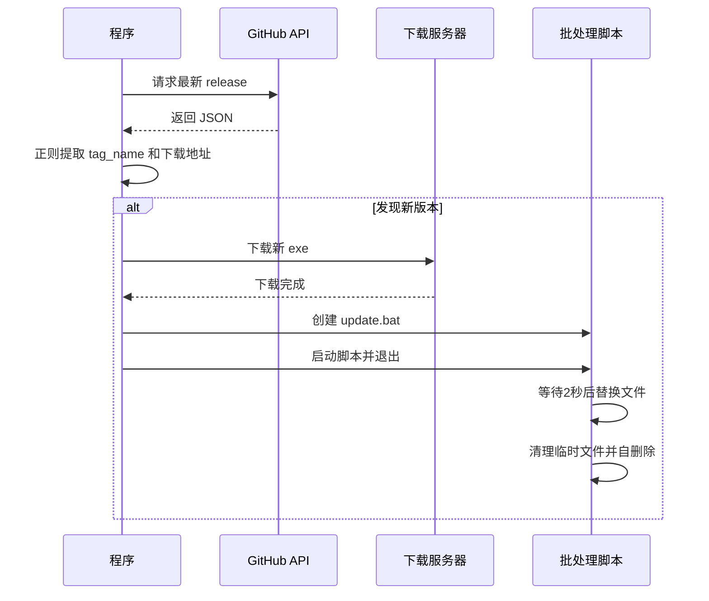

# 陈叔叔希沃优化工具 (SeewoOptimizer)

**PEACE & LOVE | 川中计算机协会 荣誉出品**

---

## 📖 简介

陈叔叔希沃优化工具是一款专为**老希沃/多媒体教室环境**设计的轻量级系统优化工具。它解决了多媒体设备常见的三大痛点：

- **系统时间不准确**（因主板电池失效或 Windows Time 服务异常）
- **音量过小老师不会调导致同学们不能愉快地观看课件内视频**（不知道要退出ppt调系统时间）
- **WPS 2019无法打开课件**（需要结束wps.exe进程再打开课件）

本工具完全**绿色、静默、自动**，无需用户干预即可完成时间同步、音量调节和进程清理，并支持开机自启和自动更新。

---

## ✨ 功能特性

| 功能 | 说明 |
|------|------|
| 🕐 **NTP 时间同步** | 内置 10 个国内外 NTP 服务器（阿里云、苹果、谷歌、NIST 等），自动重试、支持多阶段切换 |
| 🔊 **系统音量调节** | 可自定义开机音量百分比，调用 Windows Core Audio API 直接调节主音量 |
| 🧹 **结束 WPS 进程** | 一键清理 wps.exe |
| 🔄 **开机自启** | 通过 Windows 任务计划实现用户登录后自动启动（无需管理员权限） |
| 🤫 **静默启动** | 启动后自动隐藏到系统托盘，不干扰日常使用 |
| 📦 **自动更新** | 后台检测 GitHub Releases，静默下载并替换，无弹窗无打扰 |
| 📝 **详细日志** | 所有操作记录在 `%LOCALAPPDATA%\SeewoOpt\startup.log` |
| 🧹 **一键卸载** | 输入暗号 `0319` 后清理所有日志、注册表、任务计划（需手动删除 exe） |
| 🌐 **开源仓库** | 内置跳转按钮，一键访问 GitHub 源码 |

---

## 🖼️ 界面预览


- 主窗口实时显示同步日志
- 右下角按钮支持：重新同步、显示窗口、隐藏到托盘、GitHub仓库、卸载程序

---

## 🚀 使用方法

### 1. 首次运行

从[Release发布页](https://github.com/Foxelf-Studio/SeewoOptimizer/releases)下载最新版，放到任意一个文件夹，双击 `SeewoOpt.exe`，程序将自动：

- 添加计划任务开机自启
- 调节系统音量（默认 60%）
- 结束 WPS 进程
- 从多个 NTP 服务器同步时间（自动选择可用服务器）
- 同步成功后自动隐藏到系统托盘
- 后台检测新版本

### 2. 设置选项
点击菜单栏 **文件 → 设置** 打开设置窗口：


| 选项 | 说明 |
|------|------|
| 开机自启 | 登录后自动启动（通过任务计划实现） |
| 静默启动 | 启动时不显示主窗口，直接最小化到托盘 |
| 自动调节音量 | 勾选后每次启动将音量设为指定值（0-100） |
| 结束 WPS 进程 | 勾选后启动时自动清理 WPS 进程 |

设置自动保存到注册表 `HKCU\Software\TimeSyncTool`。

### 3. 手动同步

点击 **重新同步** 按钮可再次执行时间同步流程。

### 4. 查看日志

菜单栏 **视图 → 打开日志** 将自动打开日志文件夹并选中日志文件。

### 5. 验证守护天数

"已守护 x 天"只在**跨过午夜**时才 +1，当天无法自然验证；而且天数
**只在时间同步成功后**才刷新（时钟不可信时算出的天数是错的，见
`Services/GuardDayPolicy.cs`）。所以按下面的方法来测。

天数起点存在注册表 `HKCU\Software\TimeSyncTool` 的 `FirstRunDate`
（REG_SZ，格式 `yyyy-MM-dd`）。改它、再点一次 **重新同步**，即可立刻看到结果——
无需重启、无需改系统时间。

> `HKCU` 是命令行里的缩写，注册表编辑器（regedit）里它的全名是
> **HKEY_CURRENT_USER**。想用图形界面就展开
> `HKEY_CURRENT_USER → Software → TimeSyncTool`；
> 但下面的命令行方式更快、不会点错（`HKCU` 在 cmd 里直接可用）。
> 键不存在时 `reg add` 会自动创建。

**开始前先看一眼当前状态**（这条也会告诉你注册表里到底有什么）：

```cmd
reg query "HKCU\Software\TimeSyncTool"
```

**① 验证正常递增**

把起始日设为**昨天**（下例假设今天是 2026-10-11）：

```cmd
reg add "HKCU\Software\TimeSyncTool" /v FirstRunDate /t REG_SZ /d 2026-10-10 /f
```

点 **重新同步** → 同步成功后界面应显示 **第 1 天**，日志出现
`守护天数已刷新：第 1 天`。

**② 验证错误起点会被自动修正**（复现历史上的"9781 天"缺陷）

```cmd
reg add "HKCU\Software\TimeSyncTool" /v FirstRunDate /t REG_SZ /d 2000-01-01 /f
reg delete "HKCU\Software\TimeSyncTool" /v LastKnownGuardedDays /f
```

重启程序 → 界面显示占位文案「正在确认守护天数…」，**不会出现 9781**
（时钟不准时不再现算）。点 **重新同步** → 应显示 **第 0 天**，日志出现：

```
守护起始日期 2000-01-01 早于本功能上线日（2026-10-10），不可能成立，已重置为 2026-10-11
守护天数已刷新：第 0 天
```

把日期改成**明天**可测另一条分支，日志会写"晚于今天…已重置"。

**③ 验证时钟不准时不会算出假数字**

把系统时间改到 2000-01-01，重启程序、**先不要同步**：
界面应显示上次确认过的值（全新安装时是占位文案），
而不是按 2000 年算出来的天文数字。此时再同步，应显示第 0 天。

> **注意**：起始日早于 `2026-10-10`（守护天数功能上线日）一律会被判为
> 不可信并重置。所以手工填一个很早的日期走的是 ② 那条重置路径，
> 想看"较大的天数"只能靠真实时间累积。

**恢复**：把 `FirstRunDate` 改回首次运行的日期，或删掉该值重新开始：

```cmd
reg delete "HKCU\Software\TimeSyncTool" /v FirstRunDate /f
reg delete "HKCU\Software\TimeSyncTool" /v LastKnownGuardedDays /f
```

### 6. 卸载程序

点击 **卸载程序** 按钮 → 输入暗号 `0319` → 确认后自动删除：

- 日志目录
- 更新缓存目录
- 注册表项 `HKCU\Software\TimeSyncTool`
- 开机自启任务计划

**注意**：程序 exe 文件需手动删除（运行中无法自删）。

---

## 🛠️ 实现原理

### 1. 时间同步（NTP）


- 使用 UDP 协议连接 NTP 服务器（端口 123）
- 解析 NTP 协议包中的 `transmit timestamp` 字段
- 转换为本地时间（东八区）并通过 `SetLocalTime` API 设置
- 支持多阶段重试（第一阶段最多 3 次，第二阶段最多 3 次）

### 2. 音量调节

- 通过 Core Audio API 获取默认音频渲染设备
- 调用 `IAudioEndpointVolume::SetMasterVolumeLevelScalar` 设置主音量（0.0 - 1.0）

### 3. 开机自启

- 使用 `Microsoft.Win32.TaskScheduler` 库创建任务计划
- 触发器：用户登录时，延迟 5 秒启动
- 优点：无需管理员权限，不受杀毒软件拦截

### 4. 自动更新



- 使用 `WebClient` 下载，支持进度回调
- 30 秒超时控制，失败自动重试 3 次
- 批处理脚本静默替换，不弹出命令行窗口
- 更新完成后程序自动退出，下次启动即为新版本

### 5. 单实例控制

- 使用全局互斥体 `TimeSyncTool_UniqueMutex` 防止多开
- 程序退出时自动释放（无需手动释放，避免跨线程异常）

### 6. 卸载清理

- 删除 `%LOCALAPPDATA%\SeewoOpt`（日志与更新缓存）
- 顺带清理旧版本遗留的 `%LOCALAPPDATA%\TimeSyncTool`
- 删除注册表 `HKCU\Software\TimeSyncTool`
- 删除任务计划 `TimeSyncTool`
- 需要输入暗号 `0319` 确认，防止老师看它不顺眼卸载了

> 注册表项与任务计划名保留 `TimeSyncTool`，是因为它们是**已经写入系统的
> 外部键**——改名会让老用户已保存的设置被重置、已注册的自启任务失联。
> 数据目录只存日志与可再生的更新缓存，不含用户配置，因此已改名为 `SeewoOpt`。

---

## 📁 项目结构

```
SeewoOptimizer/
├── WindowsFormsApp1/            # 主工程（net48 WinForms，非 SDK-style）
│   ├── Program.cs               # 程序入口、单实例、DLL 提取
│   ├── MainForm.cs              # 主窗体
│   ├── SettingsForm.cs          # 设置窗体
│   ├── Properties/
│   │   ├── AssemblyInfo.cs      # 版本号在这里
│   │   └── app.manifest
│   ├── Services/
│   │   ├── NtpClient.cs         # NTP 协议解析（纯函数，可单测）
│   │   ├── AutoStartService.cs  # 任务计划开机自启
│   │   ├── SettingsStore.cs     # 注册表设置持久化
│   │   ├── UpdateService.cs     # GitHub Releases 自动更新
│   │   └── ...
│   ├── Microsoft.Win32.TaskScheduler.dll   # 任务计划依赖（内嵌资源）
│   └── well.ico                 # 程序图标（嵌入资源）
├── WindowsFormsApp1.sln
├── tools/                       # 构建辅助（本地构建用，CI 不需要）
│   ├── sync.cmd                 # 源码镜像：仓库 -> 本机构建工位
│   ├── build.cmd                # 同步 + 编译
│   ├── publish.cmd              # 同步 + 编译 + 签名 + 公钥自检
│   ├── Directory.Build.props    # 让各工具工程各用独立 obj（避免相互覆盖）
│   ├── NtpClientTests.cs(.csproj)      # 单元测试：NTP 协议 / 关机调度 / 守护天数 / 设置序列化
│   ├── DialogRender.cs(.csproj)        # 把关机提醒框渲染成 PNG，供人眼核对
│   ├── ShutdownSessionProbe.cs(.csproj) # 关机/注销链路探针：真实收发窗口消息
│   └── UpdateLaunchProbe.cs(.csproj)   # 更新链路的替换演练：真实模板 + 真实进程
└── .github/workflows/build.yml  # CI：编译校验 + 跑单元测试
```

---

## 🔧 编译与运行

### 环境要求

- Windows 7 SP1 或更高版本
- .NET Framework **4.8**（运行时）；编译目标同为 4.8

### 编译步骤

**推荐：用仓库自带脚本**（无需安装 Visual Studio）

```bash
cd tools
build.cmd              # Release（默认）
build.cmd Debug        # Debug
```

脚本会先把仓库源码镜像到构建工位，再编译。
首次使用需先参照 `tools/` 脚本内的路径注释准备好参考程序集与 NuGet 包。

**或者：用 Visual Studio 2022**

1. 克隆仓库
```bash
git clone https://github.com/Foxelf-Studio/SeewoOptimizer.git
```
2. 用 Visual Studio 2022 打开 `WindowsFormsApp1.sln`
3. 还原 NuGet 包
4. 编译生成（Release / AnyCPU）
5. 运行 `bin\Release\SeewoOpt.exe`

### 自动化校验

CI 在每次 push / PR 时自动编译并跑单元测试，见 `.github/workflows/build.yml`。
本地也可以单独跑 `tools/` 下的测试工程，验证 NTP 协议解析逻辑。

```bash
cd tools
dotnet run --project NtpClientTests.csproj        # 单元测试，输出"通过 N 项，失败 M 项"
dotnet run --project ShutdownSessionProbe.csproj  # 关机链路探针，退出码 0=通过
dotnet run --project DialogRender.csproj          # 渲染提醒框 PNG 到 bin/Release/net48/render/
dotnet run --project UpdateLaunchProbe.csproj     # 更新替换演练，退出码 0=通过
```

**关于 `ShutdownSessionProbe`**：它验证的是"窗口消息层"的行为——
系统关机时本程序是否会被判定为「阻止 Windows 关闭」。
这类缺陷不存在于任何纯函数里，单元测试测不到，只能用真实窗体 + 真实
`SendMessage`（投递 `WM_QUERYENDSESSION` / `WM_SYSCOMMAND(SC_CLOSE)`）
直接读回窗口过程的返回值。探针以退出码报告结果，可直接接进自动化。

> **注意**：CI 只做编译校验，不发布产物——发布需要对 exe 用本机私钥签名，
> 而私钥绝不能上传到云端。

---

## 📄 许可证

本项目采用 **GNU Affero General Public License v3.0（AGPL-3.0）**。

Copyright (C) 2025-2026 **Foxelf Studio**

完整条款见仓库根目录的 [LICENSE](LICENSE) 文件。你可以自由使用、修改和分发本项目，包括用于商业目的，但须遵守以下两条核心义务：

1. **衍生作品必须以同样的 AGPL-3.0 许可证开源。** 如果你修改了本项目并对外分发，必须提供完整的对应源代码。
2. **网络服务同样适用。** 如果你基于本项目修改后部署为网络服务供他人使用，必须向这些用户提供你修改后的源代码。（这是 AGPL 相对于普通 GPL 的关键附加条款，也是选择它的原因。）

简单说：**拿去用可以，改了要开源，别把改进藏起来。**

> 本项目为教学场景下的实用工具，按"现状"提供，不附带任何明示或暗示的担保。详见 LICENSE 第 15、16 条。

---

## 🤝 贡献与反馈

- 提交 Issue：[GitHub Issues](https://github.com/Foxelf-Studio/SeewoOptimizer/issues)
- 发邮件给我：thetimeflies@vip.qq.com
